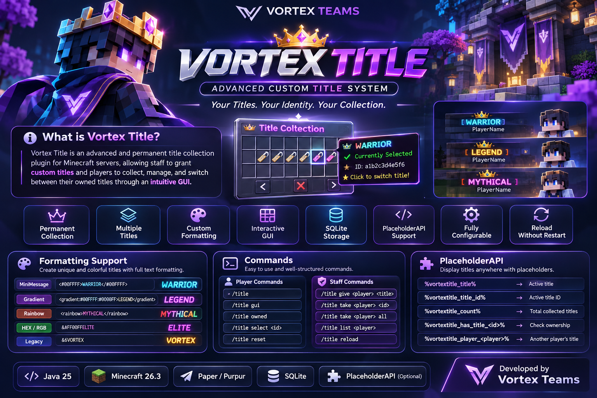

⚡ Vortex Title

  

  <b>ADVANCED PERMANENT CUSTOM TITLE SYSTEM</b>
   
  <i>Your Titles. Your Identity. Your Collection.</i>

  
  
  
  

  <b>Developed with ❤️ by Vortex Teams</b>

---

📖・About Vortex Title

Vortex Title is an advanced Minecraft title management plugin designed to provide a permanent, customizable, and flexible title collection experience.

Built for modern Minecraft servers, Vortex Title allows administrators and staff members to create and distribute custom titles directly to players without manually registering every title in configuration files.

Every granted title becomes part of the player's permanent collection.

Players can access their personal collection through an interactive GUI, browse previously obtained titles, and freely switch between their owned titles whenever they want.

Whether you're running a Survival, RPG, Economy, SkyBlock, or SMP server, Vortex Title provides a flexible title management solution for your community.

🎯・Why Vortex Title?

- 🎖️ Permanent title ownership.
- 👑 Custom title creation by staff.
- 📚 Multiple titles per player.
- 🔄 Freely switch between owned titles.
- 🎨 Advanced text formatting support.
- 💾 Persistent SQLite storage.
- 🔗 PlaceholderAPI integration.
- 🖥️ Interactive title collection GUI.

---

✨・Core Features

🎖️ Permanent Title Collection

Players can collect multiple titles without losing previously obtained titles.

Every granted title is stored individually and remains available in the player's collection.

👑 Custom Staff Management

Staff members can grant custom titles directly using commands.

Titles can contain custom names, colors, gradients, and supported text formatting.

There is no need to manually register every title in a configuration file.

🖥️ Interactive Title GUI

Players can manage their collected titles through an interactive inventory interface.

GUI Features:

- 📚 Browse owned titles.
- ⭐ Identify the currently selected title.
- 🎖️ Select previously obtained titles.
- 📄 Navigate through multiple pages.
- 🔄 Reset the currently active title.
- 💎 Display formatted custom title names.

🎨 Advanced Formatting

Create visually impressive titles using multiple Minecraft text formatting systems.

Supported input formats:

- Adventure MiniMessage.
- HEX Colors.
- RGB Colors.
- Gradient.
- Rainbow.
- Legacy Color Codes.
- RGBirdflop-compatible color codes.

💾 SQLite Database

Vortex Title uses SQLite for persistent player title storage.

Player collections and active title selections are retained across disconnects and server restarts.

🔗 PlaceholderAPI Integration

Retrieve player title information through PlaceholderAPI.

Integrate active titles with compatible chat, scoreboard, TAB, and other plugins.

⚙️ Configuration Management

Customize plugin messages, prefixes, GUI appearance, collection limits, and selection settings.

🔃 Configuration Reload

Reload supported configuration files without restarting the Minecraft server.

---

🎨・Advanced Formatting Showcase

Vortex Title supports multiple text formatting systems for creating unique and colorful custom titles.

🌈 Gradient

<gradient:#00FFFF:#0000FF>WARRIOR</gradient>

💎 HEX Color

<#00FFFF>WARRIOR

🎨 RGB Color

&#00FFFFWARRIOR

🌈 RGBirdflop Format

&x&0&0&F&F&F&F VORTEX

✨ Rainbow

<rainbow>MYTHICAL</rainbow>

💪 Bold

<bold>LEGEND</bold>

📐 Italic

<italic>ELITE</italic>

📏 Underline

<underlined>SUPREME</underlined>

🔥 Strikethrough

<strikethrough>EXCLUSIVE</strikethrough>

Additional Formatting

Adventure MiniMessage also supports additional styling, decorations, and text effects.

Formatting compatibility depends on the input parser and the plugin displaying the resulting text.

---

📦・Installation Guide

📋 Requirements

Component| Requirement
Java| 25
Minecraft| 26.3
Server Software| Paper / Purpur
PlaceholderAPI| Optional
Database| SQLite

🚀 Installation Steps

1. Download or build the Vortex Title JAR.

2. Place the JAR inside your server's "plugins" directory.

3. Install PlaceholderAPI if you need placeholder integration.

4. Restart your Minecraft server.

5. Open the generated Vortex Title configuration folder.

6. Customize the configuration according to your server requirements.

📁 Plugin Directory

plugins/
└── VortexTitle/
    ├── config.yml
    └── titles.db

---

💻・Command Documentation

👤 Player Commands

📂 Open Title Collection

/title

Opens the player's personal title collection GUI.

🖥️ Open Title GUI

/title gui

Opens the title selection interface.

📚 View Owned Titles

/title owned

Displays all titles currently owned by the player.

🎖️ Select an Owned Title

/title select <id>

Selects a previously obtained title using its unique ID.

🔄 Reset Active Title

/title reset

Removes the currently selected title without deleting the player's collection.

👑 Staff Commands

🎁 Grant a Custom Title

/title give <player> <title>

Grants a permanent custom title to the specified player.

Example:

/title give Player1 <gradient:#00FFFF:#0000FF>WARRIOR</gradient>

🗑️ Remove a Specific Title

/title take <player> <id>

Removes a specific title from the player's collection.

🚫 Remove All Titles

/title take <player> all

Removes every collected title belonging to the specified player.

📋 View Player Collection

/title list <player>

Displays the title collection of another player.

🔃 Reload Configuration

/title reload

Reloads Vortex Title configuration files.

---

🔐・Permission System

Permissions are separated between regular players and staff members for easier permission management.

👤 Player Permissions

"vortextitle.use"

- Description: Access the title collection.
- Default: "true"

👑 Staff Permissions

"vortextitle.admin"

- Description: Full administration access.
- Default: "OP"

"vortextitle.give"

- Description: Grant custom titles to players.
- Default: "OP"

"vortextitle.take"

- Description: Remove titles from player collections.
- Default: "OP"

"vortextitle.reload"

- Description: Reload plugin configuration.
- Default: "OP"

---

🔗・PlaceholderAPI Integration

Vortex Title provides PlaceholderAPI integration for retrieving title information and displaying player titles in compatible plugins.

🏷️ Available Placeholders

🎖️ Active Title

%vortextitle_title%

Returns the player's currently selected title.

🆔 Active Title ID

%vortextitle_title_id%

Returns the ID of the currently selected title.

📚 Collection Count

%vortextitle_count%

Returns the total number of titles owned by the player.

🔍 Check Title Ownership

%vortextitle_has_title_<id>%

Checks whether the player owns a specific title.

Returns:

true

or

false

👥 Another Player's Active Title

%vortextitle_player_<player>%

Retrieves another player's currently selected title.

🔧 Compatible Integrations

Vortex Title placeholders can be used with compatible:

- 💬 Chat formatting plugins.
- 📊 Scoreboard plugins.
- 📑 TAB plugins.
- 🖥️ GUI plugins.
- 🔌 Other PlaceholderAPI integrations.

Note: PlaceholderAPI is optional and must be installed separately.

---

⚙️・Configuration

Vortex Title provides configurable settings to adapt the plugin to different server environments.

📄 Main Configuration

settings:
  prefix: "<gradient:#00E5FF:#5865F2><bold>VortexTitle</bold></gradient>"

  max-titles-per-player: 0

  allow-select-command: true

gui:
  title: "<gradient:#00E5FF:#5865F2><bold>Title Collection</bold></gradient>"

  rows: 6

🔧 Configuration Options

"settings.prefix"

Customizes the plugin message prefix.

"settings.max-titles-per-player"

Sets the maximum number of titles a player can own.

"settings.allow-select-command"

Controls whether players can select titles using commands.

"gui.title"

Sets the inventory GUI title.

"gui.rows"

Sets the inventory size.

♾️ Unlimited Collection

Set the following value to "0" to allow unlimited title collections.

max-titles-per-player: 0

---

💾・Database & Data Storage

Vortex Title uses SQLite to store player title collections and active selections.

📂 Database Location

plugins/VortexTitle/titles.db

📋 Stored Information

- 🆔 Player UUID.
- 🎖️ Owned title IDs.
- 🎨 Original title formatting.
- 🕒 Title creation timestamps.
- ⭐ Currently selected title ID.

🔒 Data Persistence

Player title collections are stored independently of online player sessions.

This allows players to retain their collected titles after disconnecting or restarting the server.

Recommendation: Regularly back up the SQLite database to protect player collection data.

---

🛠️・Building From Source

Want to compile Vortex Title yourself?

📋 Build Requirements

- Java Development Kit 25.
- Gradle 9.x.
- Internet connection for dependency resolution.

1️⃣ Clone Repository

git clone https://github.com/kingdomvortex3-star/VortexTitle.git

2️⃣ Enter Project Directory

cd VortexTitle

3️⃣ Build Plugin

gradle build

4️⃣ Locate Compiled JAR

build/libs/VortexTitle-1.0.0.jar

The generated JAR can be installed on a compatible Minecraft server after successful compilation and testing.

---

🗺️・Development Roadmap

Feature| Status
Permanent Title Storage| ✅
Custom Title Management| ✅
Player Title Collection| ✅
Interactive Inventory GUI| ✅
MiniMessage Formatting| ✅
HEX & RGB Formatting| ✅
PlaceholderAPI Integration| ✅
SQLite Database| ✅
Staff Management Commands| ✅
Configuration Reload| ✅
Advanced GUI Customization| 🔜
Title Categories| 🔜
Additional Integrations| 🔜

---

🐛・Bug Reports & Suggestions

Found a bug or have an idea to improve Vortex Title?

We welcome feedback, feature requests, and bug reports.

When submitting a report, please include:

- 🎮 Minecraft server version.
- ☕ Java version.
- 📦 Vortex Title version.
- 📋 Relevant console logs.
- 🔍 Steps to reproduce the issue.

Please use the GitHub Issues section to report problems and suggest improvements.

---

🤝・Credits & Developer

  

  <b>VORTEX TEAMS</b>
   
  Minecraft Plugin Development & Engineering
   
  Custom Systems • Server Solutions • Plugin Development

---

  <b>⚡ VORTEX TITLE</b>
   
  <i>Your Titles. Your Identity. Your Collection.</i>
    
  © Vortex Teams

